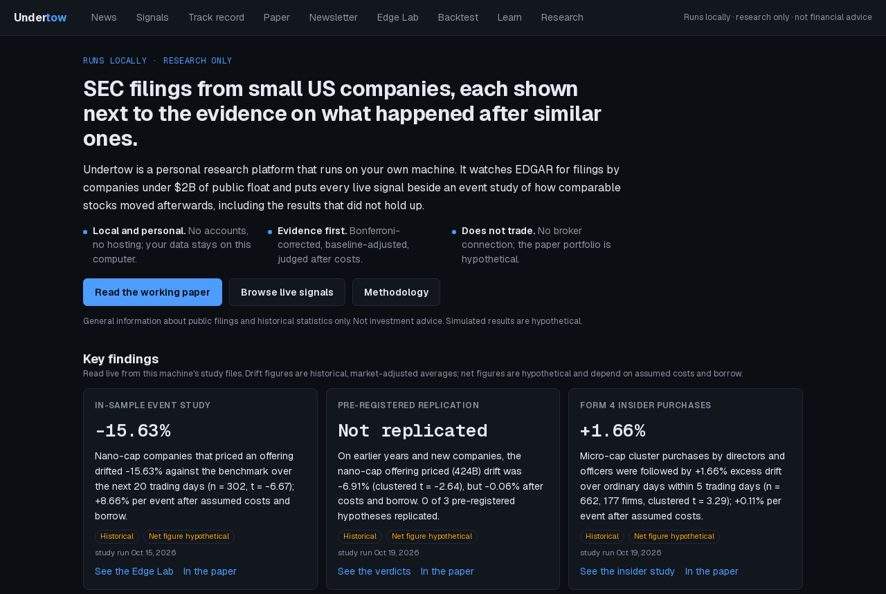
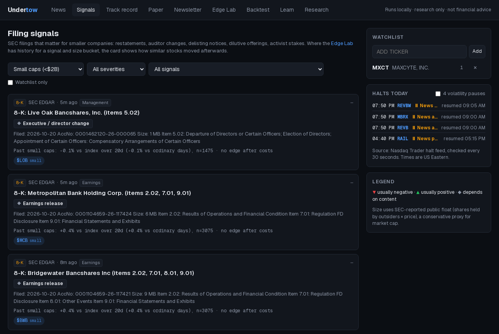
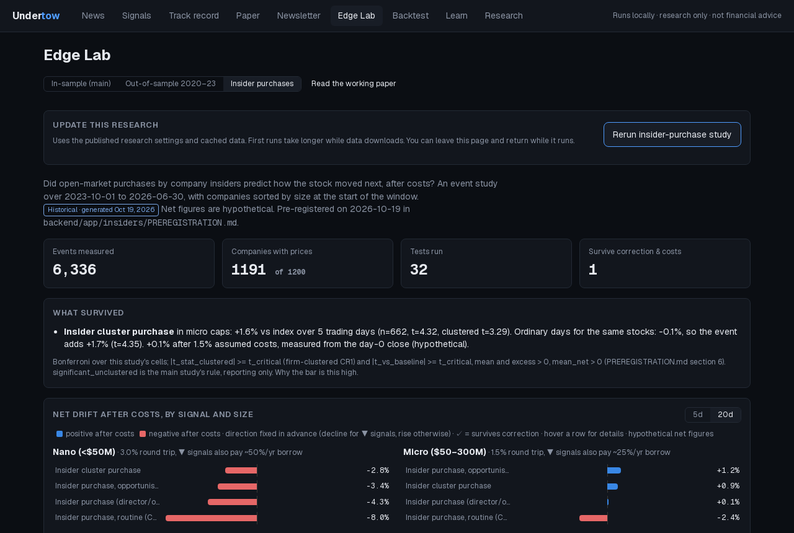
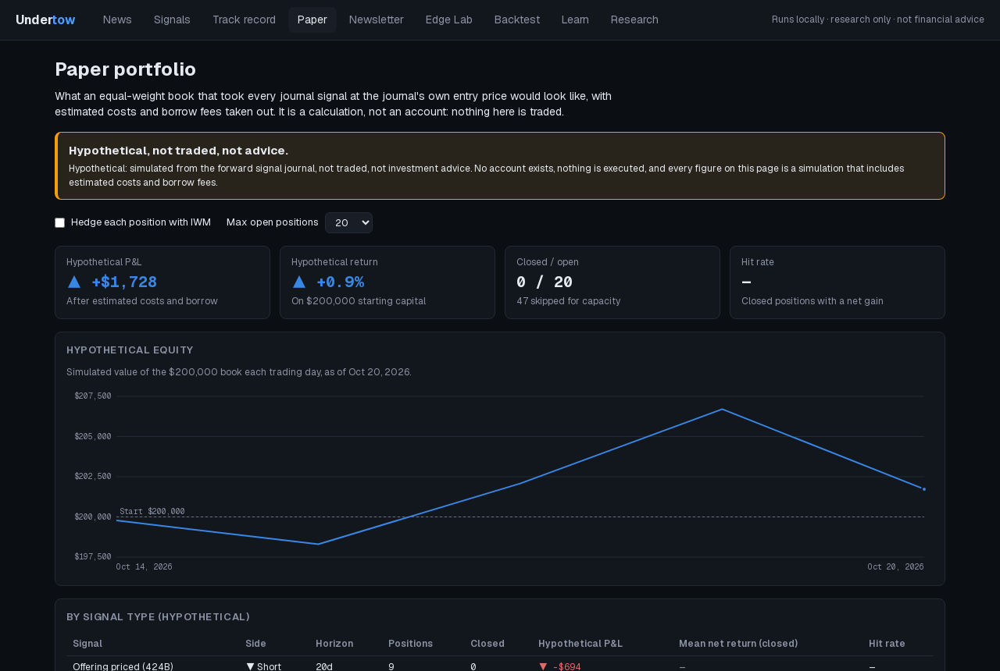

# Undertow

Undertow is a personal, locally run research platform for SEC filings by small US companies (under $2B public float).
It watches EDGAR, tags each new filing with a signal (offerings, restatements, auditor changes, insider cluster purchases
and more), and shows it next to an event study of how similar stocks moved afterwards, after costs. It runs on your own
machine with Docker, is free, has no accounts and is not hosted anywhere. It is for research and education only: it
never places orders, and every simulated number in it is hypothetical.

> Research and education only. Nothing here is financial advice or a recommendation to trade any security.

## Screenshots

| | |
|---|---|
|  |  |
| **Home:** what Undertow is and the three headline results | **Signals:** live SEC filings, each with how similar stocks moved afterwards |
|  |  |
| **Edge Lab:** the pre-registered Form 4 insider study | **Paper portfolio:** hypothetical, simulated from the forward journal |

The [working paper](docs/paper/WORKING_PAPER.md) is also rendered in the app at `/research/paper` ([screenshot](docs/screenshots/working-paper.png)).

## Status (v1.0, October 2026)

- **Published results** (raw files in [docs/results/](docs/results/)):
  - the in-sample event study ([event_study_2026-10-15.json](docs/results/event_study_2026-10-15.json)),
  - the pre-registered out-of-sample replication ([event_study_oos_2026-10-19.json](docs/results/event_study_oos_2026-10-19.json)),
  - the pre-registered Form 4 insider-purchase study ([event_study_insider_purchases_2026-10-19.json](docs/results/event_study_insider_purchases_2026-10-19.json)),
  - the portfolio backtest ([backtest_2026-10-16.json](docs/results/backtest_2026-10-16.json)).
- **Working paper:** [docs/paper/WORKING_PAPER.md](docs/paper/WORKING_PAPER.md), also rendered in the app at `/research/paper`.
  Its headline numbers are test-checked against the result files (`backend/tests/test_paper_numbers.py`).
- **Live forward test:** the one pre-registered pass, micro-cap insider cluster purchases, is now forward-tested live.
  New Form 4 filings are polled with the EDGAR loop, cluster events appear as signals labelled "forward test of
  pre-registered finding", and the track record judges them at 5 trading days.
- **Paper portfolio** (`/paper`): a hypothetical, simulated portfolio built from the forward signal journal with
  estimated costs and borrow. It is paper-only: there is no broker connection and no code path that places orders.
- **Local only:** everything binds to `127.0.0.1`. There is no paid tier, no accounts and no public deployment.

## Key findings

Summary of the [working paper](docs/paper/WORKING_PAPER.md) (also at `/research/paper` in the app). Every number below is
copied from the paper. All returns are historical, market-adjusted averages; every net-of-cost figure and every backtest
result is **hypothetical**, based on assumed costs and borrow fees, and describes nothing that was traded.

- **In-sample (Oct 2023 to Aug 2026, 21,842 measured events, 102 tests, Bonferroni |t| ≥ 3.49):** one signal survives.
  Nano-cap companies that price an offering (424B4/424B5) drift -15.63% against the Russell 2000 ETF over the next 20
  trading days (n = 302, t = -6.67), -13.67% relative to the same firms on ordinary days, and a hypothetical +8.66% per
  event after assumed costs and borrow.
- **Pre-registered out-of-sample replication (Oct 2020 to Aug 2023, fresh companies, 21,223 measured events):** not
  replicated. The nano-cap offering drift recurs (-7.57% vs ordinary days, clustered t = -2.64 against a critical value of
  2.394), but its hypothetical mean net of costs and borrow is -0.06%, so the pre-registered verdict is "not replicated".
  The other two leads fail outright (t = -0.76 and t = -0.93).
- **Hypothetical backtest of the offering effect** with realistic frictions: -33.36% total return out of sample
  (Sharpe -1.24) and -11.45% in the discovery period. The effect is a fact about prices, not a usable strategy.
- **Pre-registered Form 4 insider study (32 cells, critical value 3.16):** one cell passes. Micro-cap insider cluster
  purchases show +1.66% excess over ordinary days within five trading days (n = 662, 177 firms, clustered t = 3.29), but
  only a hypothetical +0.11% per event after a 1.5% round-trip cost. This is the result now being forward-tested live.

Full tables, design, limitations (survivorship, borrow, price data quality, single periods) and references are in the paper.

## Run it locally

Requires [Docker Desktop](https://www.docker.com/products/docker-desktop/) (running). Node 20+ is needed only for dev
mode (option C). No keys are needed: every setting in `.env` is optional.

**A. Windows, one command** (from the repo root):

```powershell
powershell -ExecutionPolicy Bypass -File scripts/start.ps1
```

[`scripts/start.ps1`](scripts/start.ps1) copies `.env.example` to `.env` if `.env` is missing, runs
`docker compose --profile web up -d --build` (Postgres, API and the web UI), and prints the URLs. Add `-NoWeb` to start
only Postgres and the API (for dev mode, below).

**B. The same with plain commands** (any OS; on macOS/Linux use `cp` instead of `copy`):

```powershell
copy .env.example .env                    # optional; skip if .env already exists
docker compose --profile web up -d --build
```

Then open <http://localhost:3000>. The API's health check is <http://localhost:8000/api/health>. The first ingest starts
right away and takes a minute or so.

**C. Dev mode** (hot reload for frontend work):

```powershell
docker compose up -d --build              # Postgres :5432 + API :8000 only (no web container)
npm --prefix frontend install             # first time only
npm --prefix frontend run dev             # UI on http://localhost:3000
```

Stop everything with `docker compose --profile web down`. Data (database, caches, study files) stays in Docker volumes.

The defaults are local and need no change: site origin `http://localhost:3000` (`PUBLIC_BASE_URL` in `.env`,
`NEXT_PUBLIC_SITE_URL` for the frontend) and API origin `http://localhost:8000` (`NEXT_PUBLIC_API_URL`). Frontend
overrides go in `frontend/.env.local` (template: the commented frontend section at the bottom of `.env.example`), never in
the root `.env`.

`docker-compose.prod.yml` is **optional / for later, not used for the local-only setup**. It is kept only as a hardened
template for a possible private server; see [Price data](#price-data) for why Undertow must not be deployed publicly.

## Optional features (off by default)

Everything works without these. Each one turns on only when its keys are set in `.env` (see `.env.example`):

| Feature | Settings | Without them |
|---|---|---|
| Email delivery (weekly newsletter, daily digest, double opt-in list) | `SMTP_HOST`, `EMAIL_FROM`, `EMAIL_POSTAL_ADDRESS` (+ other `SMTP_*` / `EMAIL_*`) | The subscribe form says email is not set up and stores nothing; newsletters are still built and archived locally |
| Discord alerts for new signal filings and halts | `DISCORD_WEBHOOK_URL` | Alerts are still evaluated and logged at `/api/alerts`, just not sent |
| Alpaca (Benzinga) news | `ALPACA_API_KEY_ID`, `ALPACA_API_SECRET_KEY` (paper keys, news only) | The feed uses EDGAR and free RSS sources |
| Claude enrichment (summaries, sentiment, filing red flags) | `ANTHROPIC_API_KEY` (`ENRICH_MODEL`, `ENRICH_MAX_PER_CYCLE`) | Articles and filings show without AI summaries |

The live insider forward test is on by default (`INSIDER_LIVE_ENABLED=true`) and needs no key; set it to `false` to stop
all Form 4 requests.

## Price data

- Research prices come from Yahoo Finance's unofficial chart endpoint and are used for **personal, local research
  only**. They are throttled and cached on your machine, never committed, redistributed or served raw by the API.
- Undertow **must not be deployed publicly** with Yahoo prices. The app shows only aggregate statistics (event-study
  averages, journal and paper-portfolio summaries), never price charts or quotes.
- Any public use would need a licensed price feed with redistribution rights first.

## What works now

**Landing page** (`/`): what Undertow is, the three key findings read live from the study files (each with a fallback
when a study has not been run on this machine), and links to every section.

**Signals tab** (`/signals`)
- Live SEC filings that carry a signal: 8-K items (restatement, auditor change, delisting notice, bankruptcy, debt default, unregistered share sale, executive change…), priced offerings (424B4/5), S-1/S-3 registrations, and Schedule 13D activist stakes.
- Insider cluster purchases (two or more directors/officers buying within 10 days, from live Form 4 filings) on micro caps, marked "forward test of pre-registered finding". They live outside the main taxonomy, so the main study's test count is unchanged.
- Every ticker is sized by SEC public float: nano (<$50M), micro, small, mid, large. Defaults to companies under $2B.
- Severity ranking, signal-type filter and a watchlist.
- Each card shows the matching study result (historical), e.g. the in-sample nano-cap offering row, or for insider clusters the insider study's micro / 5-day row.
- With an API key, the filing's actual document is summarized, and red flags (going concern, reverse split, ATM program, dilutive financing…) are extracted.

**Edge Lab tab** (`/lab`)
- Start or rerun a study from the page. The backend runs it in the background, and the page refreshes the results when it finishes.
- Event study (`backend/app/research/eventstudy.py`): after each signal type, did the stock beat or lag the index over 5 and 20 trading days, by size bucket, after assumed trading costs?
- The design is fixed up front: size measured before the window, timing by EDGAR acceptance time, market-adjusted returns, winsorized outliers, a Bonferroni correction across every test, and the measured direction chosen before seeing results.
- Reports survivorship coverage and firm-clustered t-stats next to the plain ones.
- Three studies, picked with a selector (`GET /api/research/event-study?study=main|oos|insider_purchases`):
  - **In-sample (main):** the live evidence behind every signal card.
  - **Out-of-sample 2020-23** (`backend/app/research/oos.py`): pre-registered in [PREREGISTRATION_OOS.md](backend/app/research/PREREGISTRATION_OOS.md) before any run; three confirmatory hypotheses with mechanical verdicts.
  - **Insider purchases (Form 4)** (`backend/app/insiders/`): pre-registered in [PREREGISTRATION.md](backend/app/insiders/PREREGISTRATION.md); open-market purchases of at least $10,000 by directors and officers, filing dates 2023-10 to 2026-06, with "opportunistic" vs "routine" insiders (Cohen, Malloy & Pomorski 2012).
- Runs are reproducible: `--offline` replays a study from cached inputs, every CLI run writes a hash-only input manifest, and `make reproduce` (or `bash scripts/reproduce.sh main`) compares a replay with the published `docs/results/` file.

**Research** (`/research`, `/research/paper`)
- An index of the published studies and pre-registrations, and the full working paper rendered from Markdown
  (`frontend/src/content/working-paper.md`, a byte-identical copy of `docs/paper/WORKING_PAPER.md`).

**Track record tab** (`/track-record`, `backend/app/journal/`)
- Every signal filing is recorded the moment it appears, append-only, priced at the day 0 + 1 close, and compared with IWM over 1/5/20 trading days, next to what the study expected.
- Each signal is judged on its evaluation horizon: 20 days by default, 5 days for the insider cluster forward test (a hypothetical long).
- The IBKR borrow fee at record time is captured. The journal started on Oct 13, 2026.
- **Tamper-evident seal** (`backend/app/journal/digest.py`): every completed UTC day of journal entries is hashed (SHA-256) into an append-only chain. The page shows the chain head and a full re-verification, and a day's hash can be recomputed from `GET /api/journal/chain/{day}` with the Python standard library. The launch week (Oct 13-19) was sealed after the fact and is flagged `sealed_late`.

**Paper portfolio** (`/paper`, `backend/app/paper/`; `/trading` redirects here)
- What an equal-weight book built from the journal would have done: one fixed-notional position per journal entry, long or short by the signal's prior direction, held for the signal's evaluation horizon, with the study's round-trip costs and recorded or assumed borrow fees, a max-concurrent cap and an optional IWM hedge.
- Equity curve, totals, per-signal breakdown and recent positions, all labelled hypothetical. Computed from cached prices only; no broker, no orders, no network calls.

**Backtest tab** (`/backtest`, `backend/app/backtest/`, see its [AGENTS.md](backend/app/backtest/AGENTS.md))
- Simulates the nano-cap offering short as a hypothetical daily portfolio over every 424B4/424B5 by a sub-$50M-float company, in two periods (Oct 2020 to Aug 2023 out of sample, Oct 2023 to Aug 2026 discovery):
  - Rule 201 entry delay, $1 price floor, $200k median-volume floor, volume-capped sizing.
  - 3% round-trip costs, 75%/yr borrow, 30% of names unborrowable, 2%/day recalls, squeeze stop with slippage, no credit for delistings, IWM hedge.
- Friction waterfall, 14 stress tests, a borrow-luck Monte Carlo, bootstrap intervals, a Deflated Sharpe that counts every attempt, walk-forward selection and a borrow-fee sensitivity curve.
- **Run log** of every simulation and a **live-readiness log** of 13 gates. No code path can call it ready while gates fail; the current verdict is "not ready" (it fails 8 research gates).
- **Borrow archiver:** saves IBKR's public shortable-stocks file daily.

**News tab** (`/news`)
- Live feed from free sources: SEC EDGAR 8-K filings mapped to tickers and event types; RSS (CNBC, MarketWatch, Seeking Alpha, Investing.com, PR Newswire, Federal Reserve); Alpaca/Benzinga news when keys are set.
- Dedupe by canonical URL hash plus a headline hash; ticker tagging from cashtags and exchange notation, checked against the SEC company list.
- Optional AI enrichment: one-line summary, sentiment, event type, relevance and tickers (Claude structured outputs; each result stores the model).
- Filterable feed, live updates over server-sent events, trending tickers, source health panel. Headlines link out; full article text is never republished.

**Real-time alerts** (`backend/app/alerts/`)
- EDGAR (8-K and other signal forms, plus the Form 4 forward test) is polled every 30 seconds on its own loop.
- Severity 2+ signal filings from nano/micro/small caps or the watchlist are logged at `/api/alerts` with their detection latency, and sent to Discord when `DISCORD_WEBHOOK_URL` is set (`POST /api/alerts/test` checks delivery).

**Ticker pages** (`/ticker/{SYMBOL}`, `backend/app/fundamentals/`, `backend/app/sources/halts.py`)
- Server-rendered: a factual summary paragraph with explicit dates, cash and runway from SEC XBRL, 1-year share-count change and offering history, FINRA short interest, Nasdaq trading halts with plain-English reasons, coverage and articles.
- Unknown symbols return a real HTTP 404. While the site origin is localhost, `/robots.txt` asks crawlers to stay out.

**Newsletter tab** (`/newsletter`, `backend/app/newsletter/`, see its [AGENTS.md](backend/app/newsletter/AGENTS.md))
- A weekly "Small-Cap Filing Radar" built automatically from Undertow's own data once a week is complete: headline counts, top signal filings with their historical study stat, dilution watch, serious halts, track-record progress, a research note and the disclaimer.
- Archived as JSON, Markdown and HTML under `{DATA_DIR}/newsletters/`; issues are never overwritten unless rebuilt with `--force`. Every number is labelled historical or hypothetical and the text is checked for advice words.
- Email delivery is optional (see [Optional features](#optional-features-off-by-default)); details in [delivery/AGENTS.md](backend/app/delivery/AGENTS.md).

**Learn tab** (`/learn`)
- Six server-rendered lessons (event studies, baselines, multiple testing, clustered errors, survivorship bias, Sharpe / Deflated Sharpe and backtest pitfalls) plus an 8-week curriculum, using Undertow's own numbers (labelled historical) and seeded in-browser simulators (labelled hypothetical).

**Status page and platform** (`/status`, `backend/app/health.py`, `backend/app/security.py`)
- Component health (database, ingest, EDGAR and halts pollers, journal, newsletter, alerts, email, research runs), 7-day uptime, incidents and the seal verification.
- Every change to server state (research runs, manual ingest, test alerts, watchlist) goes through one admin policy. Locally (the default `PUBLIC_BASE_URL=http://localhost:3000`) it is open on your machine; compose binds every port to `127.0.0.1`, so nothing else on your network can reach it. `ADMIN_TOKEN`, `RESEARCH_JOBS_ENABLED` and `MUTATIONS_ENABLED` can lock it down further.
- Per-client rate limits: 120 requests/min and 10 writes/min by default.

## Architecture

```
sources (EDGAR 8-K/424B/S-1/13D + Form 4, RSS, Alpaca) → dedupe → ticker tagging → Postgres → LLM enrichment (optional)
                                                                       │
            FastAPI (REST + SSE, scheduler, 30 s EDGAR poller) ────────┘ → Next.js UI (localhost:3000)
```

| Path | What |
|---|---|
| `backend/app/sources/`, `backend/app/pipeline/` | Source adapters; ingest cycle, dedupe, tagging, signal taxonomy (`ALL_SIGNALS` + `FORWARD_TEST_SIGNALS`), enrichment, SSE |
| `backend/app/research/` | Event study, pre-registered OOS study, replay manifests, Yahoo price loader, `paper_numbers.py` (paper vs results check) |
| `backend/app/insiders/` | Pre-registered Form 4 insider study and the live forward test (`live.py`) |
| `backend/app/backtest/`, `journal/`, `paper/` | Backtester; forward journal + hash chain; hypothetical paper portfolio |
| `backend/app/alerts/`, `fundamentals/`, `newsletter/`, `delivery/` | Alerts, dilution/runway, weekly newsletter, optional email delivery |
| `backend/app/main.py` | API, background scheduler and the fast EDGAR/Form 4/halts poller |
| `frontend/src/` | Next.js App Router UI |
| `docs/` | Feasibility and product research, published results, working paper, agent graph |
| `scripts/start.ps1`, `docker-compose.yml` | Local start (Windows) and the local compose stack (`web` profile for the UI container) |

## Maintenance commands

Python runs inside the `api` container (it is not needed on the host). Don't run these concurrently with a run launched
from the UI.

```bash
docker compose run --rm api python -m app.research.eventstudy        # in-sample study (~15 min first run); then:
docker compose restart api                                           # reload the evidence
docker compose run --rm api python -m app.backtest.report            # backtest (app.backtest.warm prewarms data)
docker compose run --rm api python -m app.research.oos               # pre-registered OOS study -> event_study_oos.json
docker compose run --rm api python -m app.insiders.study             # Form 4 insider study (~1-2 h first run)
docker compose run --rm api python -m app.journal.digest verify      # re-verify the hash chain (also: seal, export YYYY-MM-DD)
docker compose run --rm api python -m app.newsletter.build           # newsletter for the last completed week (--week-end, --force, --preview)
bash scripts/reproduce.sh main                                       # offline replay vs docs/results (also: oos, insiders); = make reproduce
```

Backend tests:

```bash
bash scripts/pytest.sh                       # whole suite against the current source, no image rebuild
bash scripts/pytest.sh tests/test_api.py     # one file
bash scripts/pytest.sh tests/test_paper_numbers.py   # working paper numbers vs docs/results
```

`scripts/pytest.sh` mounts `backend/` at `/app` and the repo read-only at `/repo` (so the paper test can read `docs/`).
On Windows, run it from Git Bash or WSL. CI (`.github/workflows/ci.yml`) runs the backend tests, the frontend type check,
lint and build, and builds both images on every push and pull request.

## API

| Endpoint | |
|---|---|
| `GET /api/articles?q=&ticker=&source=&sentiment=&event_type=&min_relevance=&before=&limit=` | Feed, newest first; page with `before` |
| `GET /api/articles/{id}` | One article |
| `GET /api/tickers/trending?hours=24` | Most-mentioned tickers with average sentiment |
| `GET /api/tickers/{symbol}?days=30` | Ticker detail + daily coverage |
| `GET /api/tickers/sitemap?days=180` | Tickers with a known company and recent activity |
| `GET /api/status` | Counts, enabled features, last run per source, `admin` (`protected`, `mutations_enabled`) |
| `POST /api/ingest` | Run a cycle now (admin-protected) |
| `GET /api/stream` | SSE: `article`, `article_updated` |
| `GET /api/signals?size=nano,micro,small&min_severity=&signal=&watchlist=` | Filing signals with historical evidence |
| `GET /api/signals/catalog` | Signal taxonomy (main study signals, then forward-test signals with `forward_test: true`) |
| `GET /api/research/event-study?study=main\|oos\|insider_purchases` | Event-study results (404 when that study has not been run) |
| `GET /api/research/studies` | Each study: available, `generated_at`, `n_tests`, design name |
| `GET /api/research/jobs` · `POST /api/research/jobs/{kind}` | Research jobs; start `backtest`, `event_study`, `event_study_oos` or `insider_study` (admin-protected) |
| `GET/PUT/DELETE /api/watchlist[/{symbol}]` | Watchlist (PUT/DELETE admin-protected) |
| `GET /api/backtest/report` · `GET /api/backtest/runs?limit=` · `GET /api/backtest/borrow` | Latest backtest report · run log · borrow archive status |
| `GET /api/journal?signal=&size=&status=` · `GET /api/journal/summary` | Forward track record (rows carry `evaluation_horizon`, `forward_test_label`) |
| `GET /api/journal/chain` · `GET /api/journal/chain/{YYYY-MM-DD}` · `GET /api/journal/verify` | Seal: chain head · one day's entries and hashes · full re-verification |
| `GET /api/paper-portfolio?hedge=false&max_concurrent=20` | Hypothetical paper portfolio from the journal (read-only, cached 10 min) |
| `GET /api/alerts` · `POST /api/alerts/test` | Alert config and log · test message (admin-protected) |
| `GET /api/tickers/{symbol}/fundamentals` | Cash runway, share dilution, offering history, short interest |
| `GET /api/halts?symbol=&size=&hours=` | Trading halts with plain-English reasons |
| `GET /api/newsletter/issues` · `GET /api/newsletter/{id}` · `GET /api/newsletter/{id}.html` · `POST /api/newsletter/preview` | Newsletter archive, one issue, its HTML, current week preview |
| `POST /api/subscribe` and related `/api/subscribe/confirm`, `/api/unsubscribe`, `/api/subscription/daily`, `/api/delivery/status` | Optional email delivery (503 when email is not configured) |
| `GET /api/health` · `GET /api/health/details` · `GET /api/health/history?days=7` | Liveness · per-component health · uptime history |

## What's next (research)

- Let the insider cluster forward test accumulate, then compare its 5-day results with the in-sample expectation.
- A fresh pre-registered replication of the insider cluster result on a new period.
- A pre-registered test of the micro-cap offering lead from the exploratory replication grid.
- Measured instead of assumed borrow costs: refit the borrow model from the IBKR archive after 90+ days of snapshots.
- Signal × AI-flag studies (e.g. offerings with an "ATM program" flag vs priced deals), with point-in-time scoring.

## Notes

- Free data sources are used for personal, non-commercial research. The UI shows headlines and links out; it never republishes full article text.
- Enrichment defaults to `claude-opus-5-5`; `ENRICH_MODEL=claude-haiku-5-5` costs about 40x less. `ENRICH_MAX_PER_CYCLE` caps spend per cycle.
- Tables are created with `create_all`, plus a stopgap that adds new nullable columns. Move to Alembic before real data matters.
- No Docker? The backend falls back to SQLite: `cd backend && pip install -r requirements.txt && uvicorn app.main:app --reload` (needs Python 3.12 on the host).
- Background research for the original idea is in [docs/FEASIBILITY.md](docs/FEASIBILITY.md) and [docs/PRODUCT_RESEARCH.md](docs/PRODUCT_RESEARCH.md) (the latter now background only: Undertow is local-only with no paid tier).
